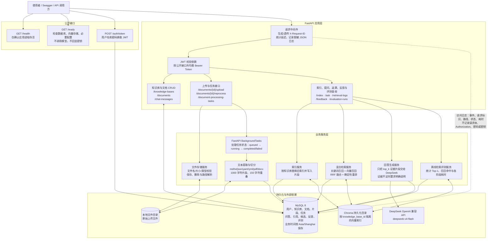
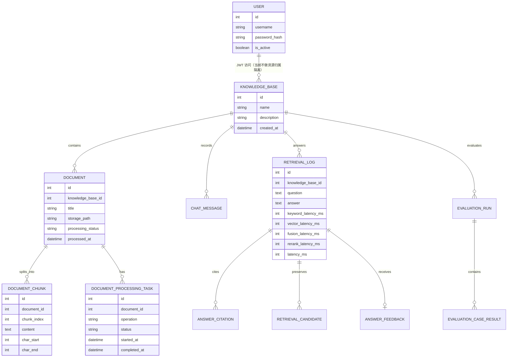
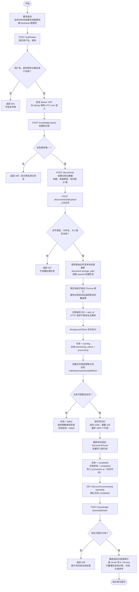
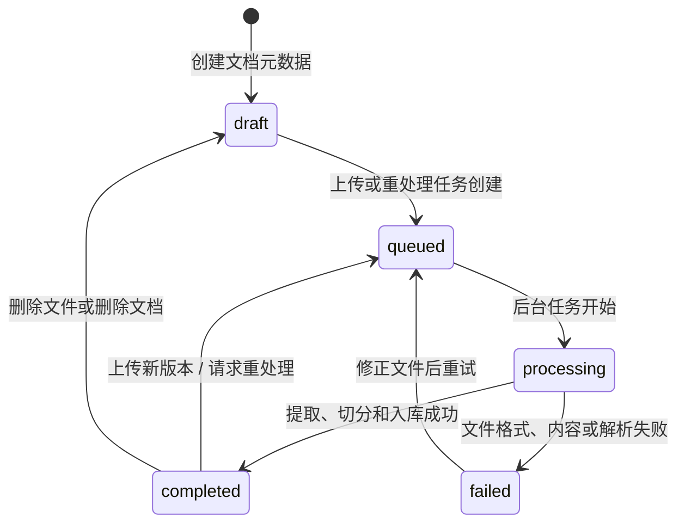
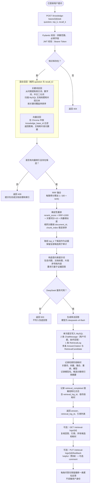
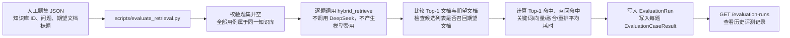
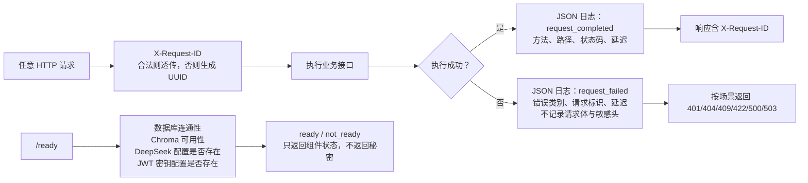

# RepoMind 系统与业务流程

本文档描述的是当前仓库已经实现、能够运行和测试的流程。RepoMind 是一个面向后端项目文档的知识库问答服务：它把项目文档处理为可检索的片段，结合关键词检索与向量检索生成带引用的回答，并留下可追溯的问答、候选、反馈和评测记录。

## 1. 系统流程图

### 系统中的职责边界

| 层级 | 负责什么 | 不负责什么 |
| --- | --- | --- |
| FastAPI 路由 | 参数校验、权限校验、状态码、协调服务调用 | 不直接实现复杂检索算法或解析文件内容 |
| MySQL | 业务实体关系、任务状态、问答审计、候选分数、反馈、评测结果 | 不保存向量索引 |
| 本地文件目录 | 保存原始上传文件，供后台任务重新处理 | 不参与在线召回 |
| Chroma | 以片段文本和元数据建立向量索引，按知识库过滤召回 | 不保存用户、问答和反馈等业务记录 |
| DeepSeek | 在给定证据范围内组织自然语言回答 | 不管理知识库、不自行检索、不保存项目数据 |
| 日志 | 观察请求、任务与检索阶段耗时，定位失败类别 | 不记录完整敏感内容或任何密钥 |

## 2. 核心数据关系与写入位置

说明：`User` 已用于 JWT 登录，但当前是本地/受信任演示部署；知识库、文档和问答记录**尚未**按用户进行资源级隔离。因此图中的 `User → KnowledgeBase` 是“通过登录访问”，不是“数据所有权关系”。

## 3. 业务流程图一：首次使用、建库和文档入库

### 文档状态机

## 4. 业务流程图二：提问、混合检索、回答与可追溯记录

## 5. 业务流程图三：离线检索评测闭环

## 6. 故障处理、观测与安全边界

当前不包含 Agent、Redis、前端、神经网络重排序模型、注册/用户管理、资源级多用户权限控制或 APISentinel 集成。Docker、MySQL、Chroma 和应用可容器化运行；CI 使用隔离测试与 fake 依赖，不需要真实模型密钥。
