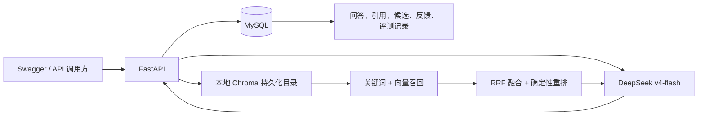

# RepoMind 架构与数据流

一次问答的数据流：文档上传后被解析、分段并保存到 MySQL；建立索引时分段被写入 Chroma。提问时，服务以 MySQL 关键词召回和 Chroma 向量召回生成候选，RRF 融合并按确定性规则重排，再把前 `top_k` 片段交给 DeepSeek 生成带引用的回答。问答、候选分数、耗时和匿名反馈会写入 MySQL。

当前不包含 Agent、Redis、前端、神经重排序模型或多用户认证。
