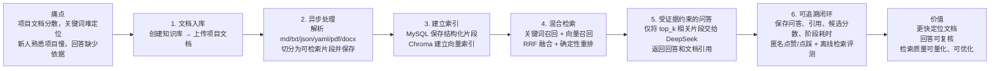

# RepoMind 面试项目流程图

这张图用于面试时介绍项目。重点不是罗列所有接口，而是说明：**项目解决什么问题、数据怎样流转、为什么结果可信、如何持续优化。**

## 面试时的讲解顺序

### 30 秒版

> RepoMind 是一个面向后端项目文档的知识库问答服务。用户上传 README、接口说明和部署文档后，系统在后台解析并切分文档，分别写入 MySQL 和 Chroma。提问时，我把关键词召回和向量召回的结果用 RRF 融合、再做确定性重排，选择最相关的片段交给 DeepSeek 生成回答，并返回引用。系统会保存候选、分数和各阶段耗时，再通过匿名反馈和离线题集评测形成可追溯的优化闭环。

### 2 分钟版

1. **从问题开始**：项目文档通常散落在 README、接口文档和部署说明中。只靠文件搜索不容易理解上下文；即使得到回答，也常常不知道依据来自哪里。
2. **先处理资料**：我将文档按知识库管理。上传后使用后台任务处理，避免用户长时间等待；系统会提取文本、按约 1000 字符切片并保存任务状态，因此失败可定位、完成可查询。
3. **再建立检索能力**：结构化数据和片段保存在 MySQL，片段向量写入 Chroma，并按知识库 ID 隔离。文档变化时会先清理旧索引，避免问答使用陈旧资料。
4. **核心亮点是混合检索**：关键词召回适合接口名、参数名等精确术语；向量召回适合自然语言表达。两路结果经过 RRF 融合，再用固定规则重排，结果具有稳定性和可解释性。
5. **回答必须可追溯**：只把前 `top_k` 片段交给 DeepSeek，提示模型在证据不足时明确说明，响应中返回引用。每次问答还会记录全部候选、排名、分数和各阶段耗时，便于复盘。
6. **工程化与闭环**：接口用 JWT 保护；日志不记录密码、授权头和密钥；`/ready` 检查关键依赖。用户可匿名点赞或点踩，另外可用人工题集离线计算 Top-1 命中、召回命中和延迟，为迭代提供数据依据。

## 一张图中的技术映射

| 流程环节 | 技术实现 | 面试中可强调的点 |
| --- | --- | --- |
| 文档管理与任务 | FastAPI、SQLAlchemy、MySQL、BackgroundTasks | 接口校验、异步处理、任务状态可追踪 |
| 文本解析与切片 | PyPDF、python-docx、字符窗口切分 | 多格式支持、重叠切片减少上下文断裂 |
| 检索 | MySQL 关键词匹配、Chroma | 精确术语与语义表达互补 |
| 排序 | RRF、确定性重排 | 不依赖黑盒重排模型，结果稳定、便于审计 |
| 回答 | DeepSeek OpenAI 兼容 API | 证据约束与引用返回，降低无依据回答 |
| 可观测性 | JSON 日志、检索运行记录、反馈、评测 | 能复盘耗时、候选与质量，而非只展示“能回答” |
| 工程化 | Alembic、pytest + HTTPX、Docker、GitHub Actions | 数据库迁移、隔离测试、容器化与自动测试 |

## 面试边界：主动说明更加分

当前版本已经实现单用户本地/受信任部署下的 JWT 保护、文档处理、混合检索、带引用问答和评测闭环；但不宣称实现了注册、多用户资源隔离、前端、Redis、Agent、神经网络重排或生产级高可用。这样能够清楚区分“已验证能力”和“后续演进方向”。
